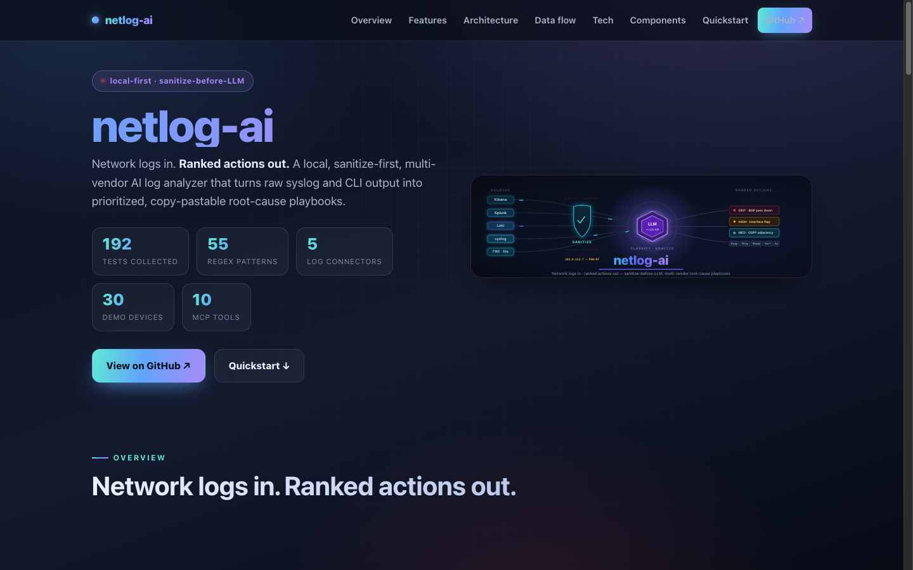
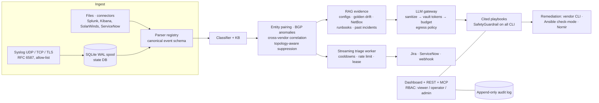
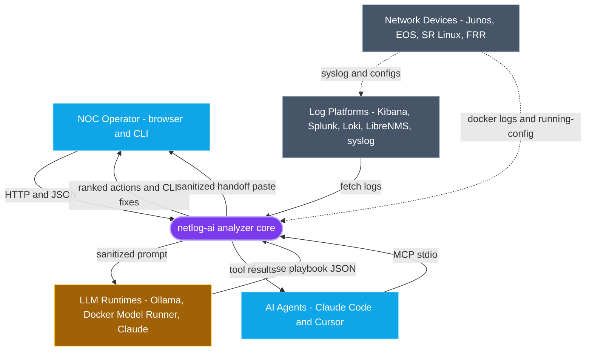
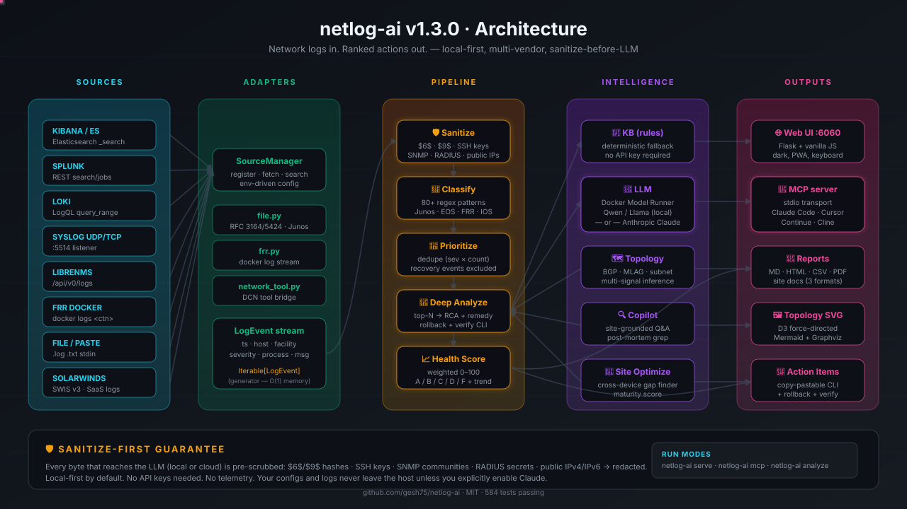

<p align="center">
  
</p>

# netlog-ai

## 📖 Live documentation

[](https://gesh75.github.io/netlog-ai/)

> 🌐 **Live:** <https://gesh75.github.io/netlog-ai/> — an animated single-page guide: architecture diagrams, data flow, tech stack, and quickstart.
>
> 🗂️ Part of the **[gesh75 documentation hub](https://gesh75.github.io/)** — all my network & AI engineering project docs in one place.


> **Network logs in. Ranked actions out.** A local, dark-themed dashboard that classifies syslog from data-center, security and SD-WAN gear (Cisco IOS-XE / NX-OS / Catalyst SD-WAN, Juniper Junos, Arista EOS, Fortinet FortiOS, Palo Alto PAN-OS, plus FRR, SR Linux, SONiC, Cumulus), correlates it across vendors into root-cause incidents, and writes evidence-cited playbooks with guarded CLI and Ansible fixes.

[](https://github.com/gesh75/netlog-ai/actions/workflows/ci.yml)    

> 📓 Release **v2.2.0** — the V2 platform: a sanitize-first LLM gateway, multi-vendor security and SD-WAN parsing with cross-vendor correlation, durable multi-worker ingest with topology-aware suppression, evidence-cited RCA with streaming ticket triage, RBAC with an audit trail, and a dashboard for all of it. Details in [`CHANGELOG.md`](CHANGELOG.md); upgrade notes in [What's new in v2.0.0](#whats-new-in-v200). v2.2.0 is a security and reliability hardening release with some **breaking defaults**, described in [Upgrade notes: hardening pass](#upgrade-notes-hardening-pass). Every environment variable is listed in [`docs/ENVIRONMENT.md`](docs/ENVIRONMENT.md); report vulnerabilities privately as described in [`SECURITY.md`](SECURITY.md).

## V2 at a glance



| Vendor / platform | Parsing & events | Remediation plan | Automation export |
|---|---|---|---|
| Cisco IOS-XE | ✓ | revert timer | `cisco.ios` · Nornir |
| Cisco NX-OS | ✓ | checkpoint / rollback | `cisco.nxos` · Nornir |
| Cisco Catalyst SD-WAN (vEdge / cEdge) | ✓ BFD, OMP, control, SLA | `commit confirmed` | refused, use vManage |
| Juniper Junos | ✓ | `commit confirmed` | `junipernetworks.junos` · Nornir |
| Arista EOS | ✓ | commit timer | `arista.eos` · Nornir |
| Fortinet FortiOS | ✓ IPsec / IKE, SD-WAN SLA, HA, BGP, conserve mode, UTM | revert mode | `fortinet.fortios` (drain) |
| Palo Alto PAN-OS | ✓ SYSTEM, TRAFFIC, THREAT, GlobalProtect, HA | snapshot + manual rollback | `paloaltonetworks.panos` (drain) |
| FRR | ✓ | vtysh auto-revert | `vtysh` + backup restore |
| Nokia SR Linux, SONiC, Cumulus | ✓ | — | — |

| Role | Can |
|---|---|
| `viewer` | dashboards, incident search, live tail, triage status, retrieval search |
| `operator` | viewer + analyze, correlate, copilot, remediation plans, ITSM enrichment, resolve incidents |
| `admin` | operator + `/api/run`, LLM provider / toggle, sources and rules, triage worker control, index rebuild, audit log |

Key settings (full list in [`.env.example`](.env.example) and [docs/OPERATIONS.md](docs/OPERATIONS.md)):

| Variable | Purpose |
|---|---|
| `AI_LOG_ANALYZER_STATE_DB` | shared SQLite WAL DB: syslog spool, incidents, LLM toggles, retrieval index, audit log, triage state |
| `ALLOW_CLOUD_FALLBACK` | default `false`: a local LLM never falls back to a cloud API |
| `LLM_TOKENIZE_HOSTNAMES`, `LLM_MAX_PROMPT_CHARS` | vault tokenization of hostnames (`auto` = cloud only) and per-provider prompt budget |
| `AI_LOG_ANALYZER_SYSLOG_ALLOW`, `AI_LOG_ANALYZER_SYSLOG_RCVBUF` | syslog sender allow-list and socket buffer |
| `AI_LOG_ANALYZER_DEPENDENCIES` | optional dependency map for topology-aware suppression |
| `AI_LOG_ANALYZER_RAG_DB`, `AI_LOG_ANALYZER_GOLDEN_DIR`, `AI_LOG_ANALYZER_RAG` | retrieval index location, golden configs, off switch (`0`) |
| `AI_LOG_ANALYZER_TRIAGE_WORKER`, `AI_LOG_ANALYZER_TRIAGE_SINKS` | start the streaming triage worker; `jira`, `servicenow`, `webhook` or `dry-run` (default) |
| `AI_LOG_ANALYZER_TRIAGE_COOLDOWN_S`, `…_MAX_TICKETS_PER_HOUR`, `…_WINDOW_S`, `…_MIN_SEVERITY` | ticket-storm controls |
| `AI_LOG_ANALYZER_VIEWER_TOKENS`, `…_OPERATOR_TOKENS`, `…_ADMIN_TOKENS`, `AI_LOG_ANALYZER_RBAC_FILE` | RBAC principals (`AI_LOG_ANALYZER_API_TOKEN` still works as admin) |
| `AI_LOG_ANALYZER_AUDIT_DB`, `AI_LOG_ANALYZER_AUDIT_LLM` | audit store (defaults to the state DB); LLM call auditing `cloud` / `all` / `off` |

---

## Why this exists

Most "AI for ops" tools either ship your data to a SaaS or hide what the model actually saw. **netlog-ai** runs entirely on your laptop:

- Configs and logs **never leave the host** — the LLM only sees pre-sanitized text (passwords, public IPs, SSH keys redacted before any outbound call).
- Pluggable LLM backend — **local Docker Model Runner** (Qwen, Llama), **Anthropic Claude**, or **xAI Grok**. No telemetry, no API keys required for the local path. Every provider is sanitize-first.
- Every finding ships with **executable CLI**: Junos `set` lines, EOS `running-config` patches, FRR `vtysh` commands, plus a rollback block and verify steps.
- Built for **multi-vendor reality** — not a Cisco-only tool retrofitted with a chatbot.

If you have ever watched an AI dashboard hallucinate a "root cause" with no actionable next step, this is the antidote.

## Upgrade notes: hardening pass

These changes shipped in v2.2.0 (see `CHANGELOG.md` → *[2.2.0]*). Some defaults are now safer and can break existing deployments:

| Area | Change | If you depended on the old behavior |
|---|---|---|
| Auth | Docker image and compose refuse to start without a token; tokens shorter than 16 characters are refused; `python -m` refuses a non-loopback bind without a token | Set a token, or `AI_LOG_ANALYZER_ALLOW_NOAUTH=1` for an isolated lab |
| File analysis | Default roots are `/var/log` plus `AI_LOG_ANALYZER_DATA_DIR`; `$HOME` and the repo are no longer readable; dotfiles and credential files are always denied | Set `AI_LOG_ANALYZER_FILE_ROOTS` |
| API | Previously open GET routes (`/api/sources`, `/api/samples`, `/api/rules`, `/api/topology`, `/api/sitedoc`, …) need a viewer token when auth is on | Send a token |
| Outbound | Connectors resolve and check hostnames and refuse private, loopback and unresolvable hosts; ITSM clients need `https://`, never follow redirects, and never send server-held credentials to a different URL | Configure operator-owned sources through `NETLOG_SOURCE_<id>_URL`, or set `NETLOG_ALLOW_PRIVATE_OUTBOUND=1` |
| MCP | Write tools (`add_source`, live ITSM/ServiceNow, SolarWinds notes) are off; HTTP transports need a bearer token | `NETLOG_MCP_ALLOW_WRITE=1`, `NETLOG_MCP_TOKEN` |
| Remediation | Exports without an assertable post-check stop for an operator `yes` and roll back if unanswered; invalid device/interface/IP values raise; `netlog-ai` CLI usage errors exit 2 | Answer the prompt, or pass valid values |
| Docker exec | `DOCKER_EXEC_FALLBACK` now defaults to `false` | Set it to `true` |
| Ingest | A listener bind error other than "address in use" now fails loudly instead of silently becoming a reader | Fix the bind address or port |
| Privacy | PUB-/user- pseudonyms use a per-process HMAC key and differ across workers and restarts | Set `AI_LOG_ANALYZER_PSEUDONYM_KEY` |

## What's new in v2.0.0

Five milestones, each its own PR:

1. **LLM gateway & reversible vault** ([#57](https://github.com/gesh75/netlog-ai/pull/57)).
   - **Single gateway:** every LLM call goes through `llm.query()`, which sanitizes first, then applies per-incident reversible tokens (`<IP_n>`, `<HOST_n>`, `<ASN_n>`), per-provider prompt budgets, and retry/backoff.
   - **No silent cloud egress:** `ALLOW_CLOUD_FALLBACK=false` by default.
   - **Guardrail:** the SafetyGuardrail screens all model-generated CLI.
2. **Multi-vendor security & SD-WAN** ([#58](https://github.com/gesh75/netlog-ai/pull/58)).
   - **Parsing:** FortiOS, PAN-OS and Catalyst SD-WAN parsers on a pluggable registry, with a canonical event schema (vendor, event type, peer IP, ASN, VRF, VNI, interface, tunnel, state, UTC time).
   - **Correlation:** down → up pairing, BGP anomaly detection (RFC 4271/4486/8203, max-prefix, path changes, flap storms) and cross-vendor correlation, so a FortiGate SLA miss → IPsec drop → Junos BGP hold-timer chain is reported as one incident.
3. **Durable ingest & automation** ([#59](https://github.com/gesh75/netlog-ai/pull/59), landed via [#60](https://github.com/gesh75/netlog-ai/pull/60)).
   - **Durable syslog:** multi-worker TCP/TLS syslog (RFC 6587, allow-list, sender attribution) into a SQLite WAL spool shared by every worker.
   - **Suppression:** topology-aware alert suppression for dead routers, HA failovers and transport loss.
   - **Automation export:** Ansible (check-mode dry run, guarded apply, rollback `rescue`) and Nornir export.
4. **Evidence, triage, RBAC & evaluation** ([#61](https://github.com/gesh75/netlog-ai/pull/61)).
   - **Cited evidence:** local BM25 retrieval over configs, golden drift, NetBox, runbooks and resolved incidents, so every playbook cites `[S#]` evidence.
   - **Streaming triage:** the worker opens Jira / ServiceNow / webhook tickets with cooldowns and a rate limit.
   - **RBAC & audit:** viewer / operator / admin roles and an append-only, hash-chained audit log.
   - **Golden-incident harness:** `ai-log-analyzer eval --golden`.
5. **V2 dashboard** ([#62](https://github.com/gesh75/netlog-ai/pull/62)).
   - **Sign-in and status:** role-token sign-in, plus a live status bar (spool, triage, LLM egress policy, vault).
   - **Incident cards:** root-cause cards with suppressed alerts and shared entities.
   - **Remediation tabs:** CLI / Ansible / Nornir, with ⛔ guardrail flags.
   - **Citations & audit:** clickable RAG citations and an audit-log viewer.

**Upgrading from 1.x**
- **Cloud fallback is off:** cloud fallback is now opt-in. Set `ALLOW_CLOUD_FALLBACK=true` to keep the old local → cloud behavior.
- **API token is admin:** `AI_LOG_ANALYZER_API_TOKEN` maps to the `admin` role, so existing tokens keep full access. Add viewer and operator tokens to narrow access. With RBAC on, sign in from the 👤 chip in the dashboard.
- **Header-less syslog hostnames:** these lines are now attributed to the sender IP instead of `syslog`.
- **Shared state DB:** set `AI_LOG_ANALYZER_STATE_DB` for multi-worker deployments. It also turns on the durable spool, retrieval evidence and the audit log.

## What's new in v1.3.0

- **Deep network analytics** (`analytics.py`): RFC 2439 exponential flap dampening (periodic timer vs bursty physical noise), Tarjan articulation-point blast radius, and config-to-log drift correlation. Stdlib only.
- **ServiceNow table source** (`sources/servicenow.py`) plus change-to-finding correlation and idempotent incident sync (`servicenow_sync.py`). Dry-run is the default.
- **21 MCP tools**, including `netlog_deep_analytics`, `netlog_servicenow_correlate_changes`, and `netlog_servicenow_sync_incident`.
- **Topology overlay.** Cytoscape classes for critical and latent SPOFs, flap storms, and correlated change badges.
- Full test suite: **632 passing tests**. Docs: <https://gesh75.github.io/netlog-ai/>

## What's new in v1.2.0

- **SolarWinds Orion + Observability SaaS connector** (`sources/solarwinds.py`): Parameterized SWQL on SWIS v3 (alert join, OLM syslog with `Orion.SysLog` fallback, `Orion.Events`), SaaS `GET /v1/logs` and `/v1/alerts` with cursor/page pagination, `build_site_manifest` / `fetch_interface_telemetry`, and explicit `AppendNote` / `Acknowledge` writeback. Configure with `SOLARWINDS_*` or `NETLOG_SOURCE_*`.
- **18 MCP tools**, including `fetch_solarwinds_logs`, `fetch_solarwinds_alerts`, and `push_solarwinds_alert_note` (explicit RCA note push only).
- **Vendor-Safe Remediation & Two-Way ITSM** from v1.1.0, **EVPN causality & telemetry fusion** from v1.0.0.
- Full test suite: **613 passing tests**. Docs: <https://gesh75.github.io/netlog-ai/>

## What's new — connectors + MCP server

netlog-ai now ships a **pluggable connector layer** so it doesn't just analyze
pasted logs — it pulls from any common log source (full guide:
[docs/CONNECTORS.md](docs/CONNECTORS.md)).

| Connector   | Source                 | One-line setup |
|-------------|------------------------|----------------|
| `kibana`    | Elasticsearch / Kibana | `NETLOG_SOURCE_kibana_URL=… NETLOG_SOURCE_kibana_API_TOKEN=…` |
| `splunk`    | Splunk REST search     | `NETLOG_SOURCE_splunk_URL=… NETLOG_SOURCE_splunk_API_TOKEN=…` |
| `loki`      | Grafana Loki           | `NETLOG_SOURCE_loki_URL=… NETLOG_SOURCE_loki_API_TOKEN=…` |
| `syslog`    | UDP/TCP listener       | Zero-config — point any device at port 5514 |
| `librenms`  | LibreNMS REST          | `NETLOG_SOURCE_librenms_URL=… NETLOG_SOURCE_librenms_API_TOKEN=…` |
| `solarwinds`| SolarWinds Orion / Observability SaaS | `NETLOG_SOURCE_orion_TYPE=solarwinds NETLOG_SOURCE_orion_URL=https://orion.example:17778` |
| `servicenow`| ServiceNow Table API (`em_alert`, `incident`, `syslog`) | `NETLOG_SOURCE_snow_TYPE=servicenow NETLOG_SOURCE_snow_URL=https://example.service-now.com` |
| `netbox`    | NetBox v4.x REST / DCIM| `NETLOG_SOURCE_netbox_URL=… NETLOG_SOURCE_netbox_API_TOKEN=…` |
| `telemetry` | Prometheus REST        | `NETLOG_SOURCE_telemetry_PROMETHEUS_URL=…` |

And the analyzer engine is now **agent-callable** via a built-in MCP server:

```bash
pip install 'netlog-ai[mcp]'
netlog-ai mcp        # stdio transport — wire into Claude Code, Cursor, Continue
```

21 agent tools exposed: `list_sources`, `add_source`, `fetch_logs`, `search_logs`,
`analyze_logs`, `get_top_offenders`, `correlate_sources`, `analyze_device`,
`list_sites`, `analyze_site`, `analyze_evpn_causality`, `generate_remediation_plan`,
`enrich_itsm_incident`, `fetch_solarwinds_logs`, `fetch_solarwinds_alerts`,
`push_solarwinds_alert_note`, `netlog_deep_analytics`,
`netlog_servicenow_correlate_changes`, `netlog_servicenow_sync_incident`,
plus healthcheck + connector inventory. See
[docs/CONNECTORS.md](docs/CONNECTORS.md) for the full reference.

## Features

| | |
|---|---|
| 🔌 **Pluggable sources** | Kibana, Splunk, Loki, LibreNMS, SolarWinds Orion/SaaS, ServiceNow, NetBox v4.x, Prometheus telemetry, syslog UDP/TCP — one Protocol, one config dict, hot-pluggable |
| 🤖 **MCP server mode** | Claude Code / Cursor / Continue can call the analyzer directly via 21 agent tools |
| 📉 **Deep analytics** | RFC 2439 flap dampening, Tarjan SPOF blast radius, and config-to-log drift, drawn on the topology map |
| 🌐 **EVPN Causal Engine** | 5-layer bipartite graph (L1 Physical → L2 Link → L3 Underlay → L4 Overlay → L5 Services) with 2-hop topological symptom suppression and root-cause isolation |
| 🔒 **Safe Remediation** | Vendor-safe change plan generation (`remediation.py`) with an automatic revert timer on the platforms that have one (Junos `commit confirmed`, IOS-XE `configure replace … time`, EOS `commit timer`; the others say plainly that there is none), a normalising destructive-command guardrail, and post-check assertions that gate the confirm step |
| 🎫 **Two-Way ITSM** | Bi-directional Jira Service Management and ServiceNow incident enrichment with deterministic `NETLOG-<SHA256>` deduplication keys |
| 📊 **Telemetry Fusion** | Optical DOM (Rx dBm) vs. QoS queue discard correlation (`telemetry.py`) to separate dirty fiber from microburst drops |
| 🗜️ **Drain-style Dedup** | Fixed-depth parse tree log clustering (`dedup.py`) with RFC 5424 PRI strip, yielding 90%+ prompt token savings during storms |
| 🗄️ **Sanitize Vault** | Stateful reversible token vault (`sanitize_vault.py`) for IPv4, IPv6, MAC, and ASN addresses across EVPN Type-2 routes |
| 🔗 **Cross-source correlation** | **Device tab** → *Correlate Sources*: scans every registered source and tags each host `confirmed` (flagged by ≥ 2 sources) or `suspected` (1) in a sortable, severity-coded table |
| 🔬 **Per-device triage** | **Device tab** → *Triage Device*: one host's verdict + 0–100 health score, severity histogram, top processes, and deduped error patterns in a single panel |
| 🔎 **Classify** | 130+ regex patterns across Junos, EOS, FRR, **Cisco IOS-XE, NX-OS, Nokia SR Linux, SONiC, Cumulus**, RFC-3164/5424 — each event carries a confidence score; add your own rules via `AI_LOG_ANALYZER_CUSTOM_RULES` / `POST /api/rules` or the UI editor |
| ⏱ **Causal console** | Timeline of the incident with cause links, blast-radius estimator, change-window correlator — in `/api/analyze` and its own UI panels |
| 🛡 **Sanitize diff** | See exactly what the LLM is allowed to see (`POST /api/sanitize-diff` + UI): per-rule redaction counts, secrets gone before any outbound call |
| 🔴 **Live tail** | Real-time SSE stream of classified events from any syslog listener source — zero polling, zero build step, server-side severity filter, its own UI panel |
| ↻ **Incident memory** | `AI_LOG_ANALYZER_INCIDENT_STORE` journals every run locally; action items get "seen 3× before (last Jul 5)" recurrence badges and `/api/incidents/similar?q=` answers "have we seen this before?" |
| 🎬 **Demo mode** | `ai-log-analyzer demo` — zero-setup synthetic incident storyline through the full pipeline; `--serve` adds a live feeder so Live Tail streams it in real time |
| 🔭 **Unknown patterns** | Lines no rule matched are template-mined (Drain-style, zero deps): variables masked, shapes clustered, error-smelling templates ranked first — novel failure modes surface instead of vanishing as `info` noise. Set `AI_LOG_ANALYZER_TEMPLATE_STORE` for cross-run memory: shapes never seen in any prior run get flagged 🆕 |
| 🧭 **Prioritize** | Deduped action items, ranked by severity × count, recovery events excluded |
| 📶 **Fabric stability** | Per-device flap detection (interface/BGP/OSPF/LAG/VPN down↔up oscillation), event-rate bursts vs the device's own baseline, trend + heuristic 24h risk band — in `/api/analyze` and its own UI panel |
| ⚖️ **LLM-as-Judge** | `ai-log-analyzer eval` scores playbooks 0–10 on actionability/safety/grounding/completeness — heuristic core, optional real LLM judge, `--min-score` CI gate |
| 🧠 **Deep analyze** | Top-N items get an LLM-written root-cause + risk + remediation playbook |
| 🛡️ **Sanitize-first** | Every config/log payload is scrubbed (`$6$`, `$9$`, SSH keys, SNMP, RADIUS, public IPs) before LLM call |
| 📈 **Health score** | Weighted formula → 0–100 + A/B/C/D/F + sparkline trend |
| 🗺️ **Topology (multi-layer)** | Cytoscape.js + ELK layered renderer — PHYSICAL · BGP · OSPF · VXLAN as separate views over the same fabric, attributes (AS / RID / VTEP) on nodes, speed/area on edges |
| 🤖 **Copilot** | Ask free-form questions, grounded in the selected site's configs |
| 🔍 **Post-mortem search** | Grep a pattern across every device in a site in one shot |
| 📄 **Report export** | Markdown / HTML / CSV / PDF + site documentation in 3 formats |
| ⌨️ **Keyboard-first** | `1/2/3` to switch tabs, `⌘/Ctrl+↵` to run, full ARIA + `:focus-visible` |
| 📱 **PWA-ready** | Installable on iOS/Android home screen; theme-color tinted dark |

## Quick start

```bash
git clone https://github.com/gesh75/netlog-ai.git
cd netlog-ai
python3 -m venv .venv && source .venv/bin/activate
pip install -e ".[dev]"
cp .env.example .env

# Run the UI
ai-log-analyzer serve
# → http://localhost:6060
```

### Docker

```bash
echo "AI_LOG_ANALYZER_API_TOKEN=$(python3 -c 'import secrets; print(secrets.token_urlsafe(32))')" >> .env
docker compose up -d                       # published on 127.0.0.1 only; refuses to start without a token
docker compose --profile lab up -d app-lab # lab variant that mounts the Docker socket (do not run alongside `app`)
```

The image runs as a non-root user and sets `AI_LOG_ANALYZER_REQUIRE_AUTH=1`, so the container will not start without an API token or RBAC tokens (16 characters minimum). Pin the base image with `--build-arg PYTHON_IMAGE=python:3.12-slim@sha256:<digest>`.

Open the UI, pick a bundled site (`lab-alpha` or `lab-bravo`) under the **🌐 Site** tab, and hit **Analyze Whole Site**. Without an LLM key the rule-based knowledge base produces the analysis; with `ANTHROPIC_API_KEY` set, Claude writes a richer narrative.

### CLI

```bash
# List running FRR-lab containers (optional)
ai-log-analyzer containers

# Analyze a stream from any source
ai-log-analyzer analyze --frr r1 r2 --no-llm | jq .score
ai-log-analyzer analyze --file /var/log/syslog
docker logs my-router 2>&1 | ai-log-analyzer analyze --stdin

# Score playbook quality (LLM-as-Judge; KB self-test by default)
ai-log-analyzer eval                 # heuristic, offline
ai-log-analyzer eval --use-llm       # blend a real LLM judge
ai-log-analyzer eval --file result.json --min-score 7   # CI gate

# Zero-setup demo (synthetic incident storyline; --serve adds live streaming)
ai-log-analyzer demo
ai-log-analyzer demo --serve

# Run the full test suite
pytest --cov=src --cov-report=term-missing
```

## Configure the LLM

Four providers, switchable at runtime from the UI dropdown — or via env / API:

| Mode          | Order |
|---------------|-------|
| `ollama`      | Ollama native API on `:11434` (default; `OLLAMA_URL` / `OLLAMA_MODEL`) → Docker Model Runner |
| `local`       | Local Docker Model Runner → Ollama |
| `claude`      | Claude first → falls back to local |
| `claude-only` | Claude only, no fallback |

Local modes **never** fall back to a cloud API unless you opt in with
`ALLOW_CLOUD_FALLBACK=true` (that also gates Claude ↔ Grok fallback).

Every call goes through one gateway (`llm.query()`) that enforces, regardless
of caller: secret/PII redaction; reversible pseudonyms for IPs, MACs, ASNs and
(for cloud providers) hostnames — `<IP_1>`, `<ASN_2>`, `<HOST_3>`, mapped back
to real values in the answer; a per-provider prompt budget; retry/backoff on
429/5xx; fencing of raw log/config text against prompt injection; and the
destructive-command `SafetyGuardrail` on every model-generated CLI line. See
`.env.example` for the knobs.

```bash
LLM_PROVIDER=claude ANTHROPIC_API_KEY=sk-ant-... ai-log-analyzer serve

# Switch at runtime
curl -X POST localhost:6060/api/llm/provider \
  -H 'content-type: application/json' \
  -d '{"provider": "claude"}'

# Disable LLM entirely (rule-based KB only)
curl -X POST localhost:6060/api/llm/toggle \
  -H 'content-type: application/json' \
  -d '{"enabled": false}'
```

### Local LLM via Docker Model Runner

```bash
docker model pull ai/qwen3        # 8B, ~5GB, recommended
# or
docker model pull ai/llama3.2     # 3B, ~2GB, faster
docker model list                 # confirm
```

Auto-detected via TCP `:12434` first, then Unix sockets (`~/Library/Containers/com.docker.docker/Data/inference.sock` on macOS, `/run/docker-model-runner/inference.sock` on Linux).

## Bundled demo sites

Four **fully synthetic** site bundles ship in `sites/` so you can exercise every feature out of the box. These are not derived from any real network — they're hand-built configs designed to demonstrate the analyzer's full feature set.

| Site | Devices | Vendors | What it shows |
|------|---------|---------|----|
| `lab-alpha` | 5 (2 SRX HA pair + 1 MX router + 2 EOS switches) | Junos + EOS | Cross-vendor edge, chassis-cluster, MLAG |
| `lab-bravo` | 6 (1 SRX firewall + 2 MX spines + 3 EX leaves) | Junos | Spine/leaf fabric, iBGP full mesh |
| `clab-clos-evpn` | 9 (3 spines + 6 leaves) | **Nokia SRL + Arista cEOS + FRR** | Mixed-vendor Clos EVPN-VXLAN fabric, L2/L3 VNIs, route reflectors |
| `dcn-lab` | 10 (5 cores + 3 edges + 2 dists) | FRR | Multi-POP backbone (DE-FRA · UK-LON · NL-AMS · US-NYC), eBGP + OSPF area 0 |

Each bundle includes intentional configuration gaps (missing BFD, no LLDP on some access switches, IoT VLAN without an L3 interface) so the analyzer's deep-analysis pipeline produces concrete, actionable findings.

## Multi-layer topology

The topology view stacks four protocol overlays over the same fabric — each with the data that's actually relevant to that protocol. Drag a node to pin it; positions persist across layer toggles (BGP, OSPF, VXLAN all follow the L1/L3 layout). Reset Layout reruns ELK from scratch. Full reference: [docs/TOPOLOGY.md](docs/TOPOLOGY.md).

- **PHYSICAL** — node label: `hostname`; edge: `Et1` · `eth3` · `et1/3` at each end, link speed (e.g. `10G`, `100G`) at midpoint parallel to the line; IPs revealed via the **Show IPs** toggle. Solid blue.
- **BGP** — node label: `hostname · AS65001`; edge: `EBGP` / `IBGP` tag only (AS already on each node). Purple; eBGP solid w/ arrow, iBGP dashed.
- **OSPF** — node label: `hostname · RID 10.0.0.1`; edge: `area 0` (per-adjacency). Green dashed.
- **VXLAN** — node label: `hostname · VTEP 10.255.1.4`; edge: `VNI 10010,10020,10030` (only where VNIs differ). Coral dashed.

When a layer has no edges anywhere on the site (e.g. OSPF on a pure-BGP fabric), the view shows the devices as a list with an explicit empty-state banner instead of silently falling back.

### Speed inference

Link speed is resolved in this order:

1. **Explicit config directive** — EOS/IOS `speed 100g`, SRL `port-speed 100G`, Junos `gigether-options speed 100g`.
2. **Interface-name convention** — `HundredGigE*` → 100G, `TenGig*` / `xe-*` → 10G, `GigabitEthernet*` / `ge-*` → 1G, `et-*` → 40G, `mge-*` → 100G. Skipped for ambiguous names like `Ethernet1` / `eth1`.
3. **Site default** — `manifest.json` may declare `"default_link_speed": "10G"` (used by all four bundled sites for the docker veth links).

The link rate displayed is `min(src_speed, dst_speed)` — mismatches are surfaced so you can act on them.

### Multi-vendor parsing coverage

The topology engine ingests configs from every shipped sample:

- **Junos** — `set interfaces ... family inet address ...`, `gigether-options speed`, OSPF area, chassis-cluster, BGP `local-as` / `peer-as`.
- **Arista EOS** — `interface EthernetN { ip address ... speed ... }`, `router bgp`, `vxlan source-interface`, OSPF process.
- **Nokia SRL** — `interface ethernet-1/X { subinterface 0 { ipv4 { address ... } } }`, `system0` loopback as implicit VTEP when `afi-safi evpn` is signaled.
- **FRR** — Quagga-style block syntax, `interface lo` as implicit VTEP when `advertise-all-vni` is present, `vrf X { vni Y }` for L3 VNIs.

### Auto-detection fallback parser (optional)

```bash
pip install netlog-ai[parse]
```

For arbitrary `show` output where the platform isn't known up-front, the adapter scores
ntc-templates TextFSM templates and returns the best match:

```python
from ai_log_analyzer.adapters.tfsm_auto import auto_parse
result = auto_parse(raw_cli_output, filter_hint="bgp_summary", min_score=40.0)
```

<p align="center">
  
</p>

See [`docs/TFSM_AUTO_PARSER.md`](docs/TFSM_AUTO_PARSER.md) for the API, scoring guide,
and filter-hint reference. The full WebM video is [`demo/tfsm_demo.webm`](demo/tfsm_demo.webm)
(19s, 311 KB) and the recording is reproducible via [`demo/record_tfsm_demo.sh`](demo/record_tfsm_demo.sh).

## DCN AI port — correlation, triage, and expanded KB (2026-06-02)

Four capabilities backfilled from the closed-source DCN AI Intelligence Center:

- **Multi-source correlation** — `correlate_sources` MCP tool classifies events from every registered source and tags each device `confirmed` (seen in ≥ 2 independent sources) or `suspected` (1 source only). Eliminates single-source noise before escalation.
- **Richer RCA KB** — every KB entry (`bgp`, `ospf`, `interface`, `lag`, `hardware`, `compliance`, `security`, `system`) now carries a structured `rca` block: numbered root-cause list, risk sentence, ordered resolution steps, and copy-pastable Junos / EOS CLI commands. Two new categories added: `vpn` (IKE/IPsec failure) and `redundancy` (VRRP/HSRP failover); `hardware` extended with `fpc` (line-card errors) and `chassis` (PSU/fan/temperature alarms).
- **Expanded classifier patterns** — `inetd|xinetd|ftpd` added as a low-severity `system` pattern, positioned after all high-severity patterns so first-match-wins is preserved. Three new unit tests confirm matching and priority ordering.
- **Per-device triage** — `analyze_device` MCP tool pulls one hostname's events from all sources, returns a severity histogram, process breakdown, frequency-deduped error patterns, a KB verdict (e.g. `ROUTING`, `HARDWARE`), and a 0–100 health score.

Full details and usage examples: [`docs/PORTED_FROM_DCN_AI.md`](docs/PORTED_FROM_DCN_AI.md).

## LOGS pipeline hardening (2026-05-27)

Three follow-up fixes to the LOGS tab: (1) the Executive Summary LLM call now
receives an `ALLOWED_HOSTNAMES` anchor and a post-validation scrubber so it
can no longer emit textbook placeholders like `R1-R3` or `SW1-SW2`,
(2) `classifier.strip_ansi` removes ANSI/VT100 escape codes from every event
at the LogEvent → ClassifiedEvent boundary (no more `[0;32m  OK  [0m` garbage
in the UI), and (3) `containerlab-multivendor/topologies/clos-evpn.clab.yml`
now caps cEOS / SRL / linux containers via the `kinds:` block so a runaway
control plane can't OOM-cascade the host. Full details and live validation
data in [`docs/LOGS_PIPELINE_HARDENING.md`](docs/LOGS_PIPELINE_HARDENING.md).

## Site-Wide Optimization — split scoring + hostname anchoring

The Site-Wide Strategic Optimization widget now returns **two independent scores** instead of a
single ambiguous "maturity" number: `fabric_design_score` (routing, HA, lifecycle, BGP tuning,
overlay) and `operational_readiness_score` (NTP, syslog, AAA, SNMPv3, monitoring, compliance).
This separates architectural gaps from day-2 hygiene so an engineer knows whether to plan a
hardware change or just push config. The LLM prompt also injects an explicit `ALLOWED_HOSTNAMES`
inventory and post-validation drops any `config_changes` key not in that list — no more invented
`CR-01` / `BR-01` placeholders. Full design and validation in
[`docs/SCORING_SPLIT.md`](docs/SCORING_SPLIT.md).

## 🏛️ Architecture

The analyzer core sits between the operators who drive it (browser, CLI, or AI agents over MCP), the log
platforms it pulls from, the LLM runtimes it can call, and the network devices that produce the logs and
configs. **Every outbound LLM call is gated by the sanitizer.** Full diagram set —
container map, runtime sequence, data-flow pipeline, provider-fallback state machine, ER model, and module
map — lives in **[docs/ARCHITECTURE.md](docs/ARCHITECTURE.md)**.



<p align="center">
  
</p>

> **Flow:** any source (Kibana, Splunk, Loki, syslog, LibreNMS, SolarWinds, FRR, file) → `SourceManager` adapter → **sanitize → classify → prioritize → deep-analyze → score** → outputs (Web UI, MCP server, reports, topology, copy-pastable CLI). Every byte that touches the LLM is scrubbed first.

<details>
<summary>ASCII fallback (for terminals / RSS readers)</summary>

```
┌────────────────────────────────────────────────────────────────────┐
│                  Browser (vanilla JS, no build)                     │
│                  index.html + app.js                                │
└──────────────────────────────┬─────────────────────────────────────┘
                               │ HTTP / JSON
┌──────────────────────────────▼─────────────────────────────────────┐
│                Flask  (port 6060)                                   │
│                                                                     │
│  Adapters → Classifier → Action Items → Health Score → AI Summary  │
│     │           │              │              │             │       │
│     ▼           ▼              ▼              ▼             ▼       │
│  FRR docker  50+ regex     dedupe by    weighted formula  LLM or    │
│  File        patterns      (sev, desc)  → A/B/C/D/F       KB        │
│  Stdin/raw                                                          │
└─────────────────────────────────────────────────────────────────────┘
```

</details>

### Module layout

```
src/ai_log_analyzer/
  classifier.py        50+ regex patterns + severity/category lookup + custom rules
  patterns.py          Drain-lite template miner for lines no rule matched
  stability.py         Flap/burst/trend scoring + 24h risk per device
  judge.py             LLM-as-Judge playbook quality scoring (eval CLI)
  memory.py            Incident journal — recurrence badges + similarity search
  demo.py              Synthetic incident storyline + live feeder (demo CLI)
  kb.py                Rule-based deep-analysis KB (fallback when LLM is off)
  llm.py               Docker Model Runner (TCP + UDS) + Anthropic Claude
  analyzer.py          End-to-end pipeline: classify → actions → score → summary
  copilot.py           Site-context Q&A with secret-sanitized prompts
  diff.py              Config-diff explainer
  sanitize.py          Pre-LLM redaction (passwords, public IPs, SSH keys)
  site_optimize.py     Site-wide cross-device gap finder + maturity score
  site_diagram.py      Mermaid + Graphviz DOT topology renderer
  topology.py          Build topology graph from device list
  topology_infer.py    Multi-signal edge inference (BGP, MLAG, descriptions, subnets)
  reports.py           MD / HTML / CSV / PDF report exporters
  adapters/
    frr.py             docker logs <container> → LogEvent stream
    file.py            RFC3164 / RFC5424 / Junos / freeform parser
  web/
    app.py             Flask routes + create_app()
    static/            index.html + app.js (no build step)
  cli.py               `ai-log-analyzer serve | analyze | containers`
```

## API

| Method | Endpoint | Description |
|--------|----------|-------------|
| `GET`  | `/api/health` | Liveness check |
| `GET`  | `/api/llm/status` | Provider + availability for each provider |
| `POST` | `/api/llm/provider` | `{"provider": "ollama"\|"local"\|"claude"\|"claude-only"\|"grok"}` |
| `POST` | `/api/llm/toggle` | `{"enabled": true\|false}` |
| `GET`  | `/api/lab/containers` | Running FRR-lab container names |
| `GET`  | `/api/sites` | List bundled site bundles |
| `POST` | `/api/analyze` | Full pipeline — see request shapes below (response includes `unknown_patterns`: mined templates of unmatched lines) |
| `GET`  | `/api/rules` | Built-in rule count + registered custom classification rules |
| `POST` | `/api/rules` | Add custom rules at runtime — `{"rules": [{"pattern", "severity", "category", "description"}]}` |
| `GET`  | `/api/tail/<source_id>` | SSE live stream of classified events (`?min_severity=`; token in a header, never `?token=`) |
| `GET`  | `/api/incidents/similar` | Free-text search over the local incident journal (`?q=`, needs `AI_LOG_ANALYZER_INCIDENT_STORE`) |
| `POST` | `/api/sanitize-diff` | Preview the sanitize-before-LLM gate on pasted text (`original`, `sanitized`, `total`, `by_rule`) |
| `POST` | `/api/optimize` | Device-level config audit + patches |
| `POST` | `/api/optimize/site` | Cross-device site analysis |
| `POST` | `/api/optimize/site-wide/<id>` | Strategic maturity scoring + phased roadmap |
| `POST` | `/api/correlate` | Cross-source correlation — confirmed (≥ 2 sources) vs suspected (1) devices |
| `POST` | `/api/triage` | Per-device triage — verdict, health score, severity histogram, top processes, patterns |
| `GET`  | `/api/topology/<id>` | Topology graph (JSON / Mermaid / DOT) |
| `GET`  | `/api/compliance/<id>` | Compliance rules pass/fail |
| `POST` | `/api/copilot` | Free-form Q&A grounded in selected site config |
| `POST` | `/api/postmortem/<id>` | Pattern search across all devices in a site |

### `/api/analyze` request

```json
{
  "source": "frr",
  "containers": ["r1", "r2"],
  "tail": 500,
  "use_llm": true
}
```

```json
{
  "source": "raw",
  "hostname": "test-router",
  "text": "Mar  3 12:00:01 r1 rpd[1234]: bgp peer 10.0.0.1 down\n..."
}
```

## Security defaults

- **Sanitize-before-LLM** — every config/log payload is run through `sanitize.py` before any outbound call. Coverage:
  - Linux/BSD shadow hashes (`$1$`, `$5$`, `$6$`)
  - Junos `$9$` proprietary encoding
  - SSH keys (RSA / Ed25519 / ECDSA / DSS)
  - SNMP communities, RADIUS / TACACS+ keys
  - IPsec pre-shared keys
  - Public IPv4 addresses (mapped to RFC-5737 doc prefixes for the LLM context)
- **Localhost bind by default** — set `ANALYZER_HOST=0.0.0.0` to expose; the server warns if you bind publicly without an API token.
- **API-token gate** — set `AI_LOG_ANALYZER_API_TOKEN=...` to require the token on every POST, supplied as either `X-API-Token: <token>` or `Authorization: Bearer <token>`. That shared token is the `admin` role.
- **Role-based access** — `AI_LOG_ANALYZER_VIEWER_TOKENS` / `_OPERATOR_TOKENS` / `_ADMIN_TOKENS` (`name:token,...`) or `AI_LOG_ANALYZER_RBAC_FILE` (SHA-256 token hashes). Viewers read dashboards, operators analyze and work incidents, only admins run commands, change LLM providers or edit configuration.
- **Audit trail** — with `AI_LOG_ANALYZER_STATE_DB` (or `AI_LOG_ANALYZER_AUDIT_DB`) set, privileged actions, denied attempts, external LLM calls and triage tickets are written to an append-only, hash-chained `audit_log` table (`GET /api/audit`, `/api/audit/verify`).
- **CORS allow-list** — `AI_LOG_ANALYZER_CORS_ORIGINS=https://a.com,https://b.com`.
- **File-ingest confinement** — `AI_LOG_ANALYZER_FILE_ROOTS=~:/var/log` bounds what `{source:"file"}` may read.
- **No telemetry** — outbound calls go only to (a) the LLM provider you select and (b) the local Docker socket if you analyze FRR-lab containers.

## Tested & accessible

- **2,100+ unit + integration tests** (pytest)
- Frontend audited across 8 review rounds:
  - WCAG-AA: `:focus-visible` rings, `aria-live` regions, `role=tablist/tab/tabpanel`, skip-to-main link, `prefers-reduced-motion` fallback
  - Responsive ≤ 1100px, PWA-ready (`theme-color`, `mobile-web-app-capable`, SVG favicon)
  - Performance: `content-visibility: auto` panel culling, `contain: layout`, deferred scripts, preconnect hint
  - Keyboard: `1/2/3` to switch tabs, `⌘/Ctrl+↵` to run, semantic `<kbd>` hints throughout
  - Print stylesheet for hardcopy reports

## Roadmap

- [ ] Multi-site comparison view (delta between two sites)
- [x] Real-time tail mode — SSE stream (`/api/tail/<source>`) + Live Tail UI panel
- [x] Slack / generic-JSON alert webhooks per severity threshold (`AI_LOG_ANALYZER_WEBHOOK_URL` — see `.env.example`)
- [x] More vendor coverage — Cisco IOS-XE + NX-OS + Nokia SR Linux + SONiC + Cumulus (NVUE/NCLU, clagd, switchd, PTMD)
- [x] Custom classification rules — JSON file (`AI_LOG_ANALYZER_CUSTOM_RULES`) + runtime `POST /api/rules` + UI editor
- [x] xAI Grok as a first-class sanitize-first LLM backend
- [x] Causal timeline, blast-radius estimator, change-window correlator
- [x] Incident memory — local journal with recurrence badges + `/api/incidents/similar`
- [x] One-command demo mode (`ai-log-analyzer demo [--serve]`)
- [x] Golden-incident replay for regression testing (`ai-log-analyzer eval --golden`)
- [x] Config + incident retrieval with cited evidence in every RCA (`ai-log-analyzer rag`)
- [x] Streaming triage worker with ServiceNow / Jira / webhook ticketing and storm controls
- [x] RBAC (viewer / operator / admin) and an append-only audit trail
- [x] Unknown-pattern template mining — Drain-style clustering of unmatched lines, surfaced in UI/API/MCP
- [x] Cross-run template persistence — `AI_LOG_ANALYZER_TEMPLATE_STORE` flags never-before-seen shapes (🆕)
- [x] Fabric stability scoring — flap/burst/trend detection + 24h risk band per device
- [x] LLM-as-Judge playbook quality scoring (`ai-log-analyzer eval`, CI-gate ready)

## Contributing

PRs welcome. See [CONTRIBUTING.md](CONTRIBUTING.md) for the short version. The whole stack is one `pip install -e ".[dev]" && pytest` away.

## License

MIT — see [LICENSE](./LICENSE).

---

Built by [@gesh75](https://github.com/gesh75) as part of a multi-vendor network automation toolkit.
